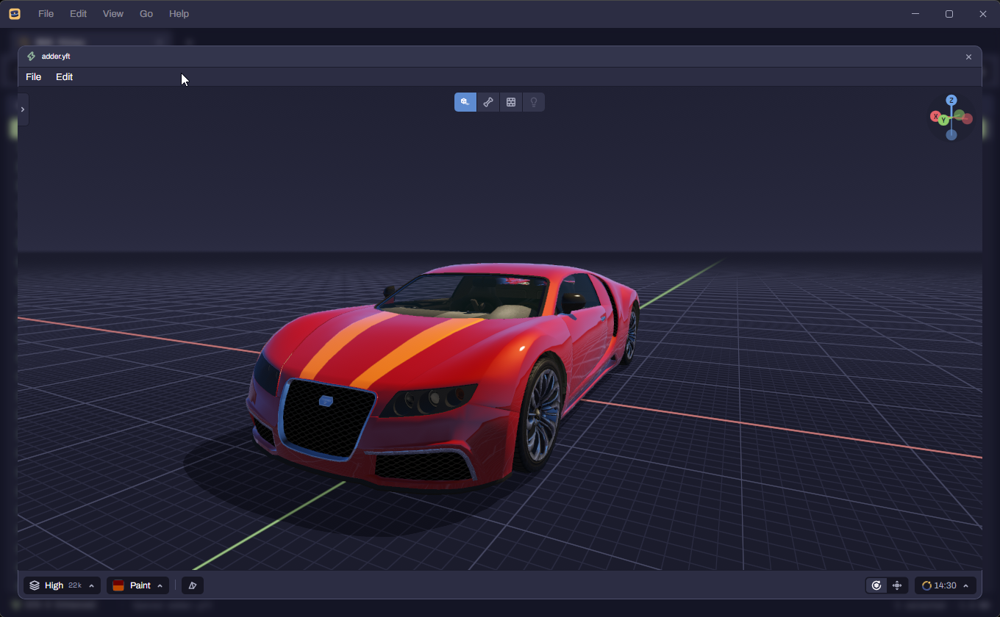
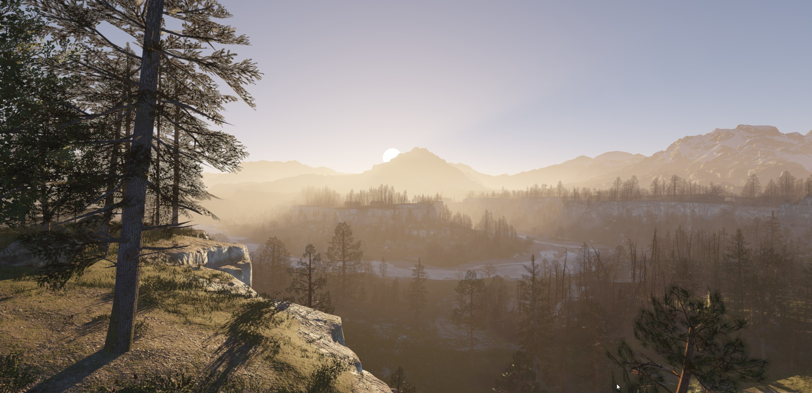
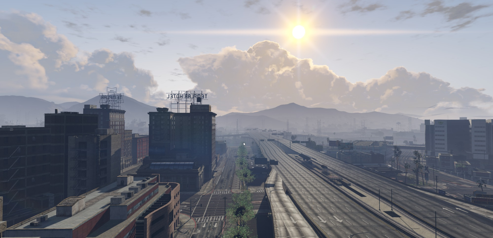
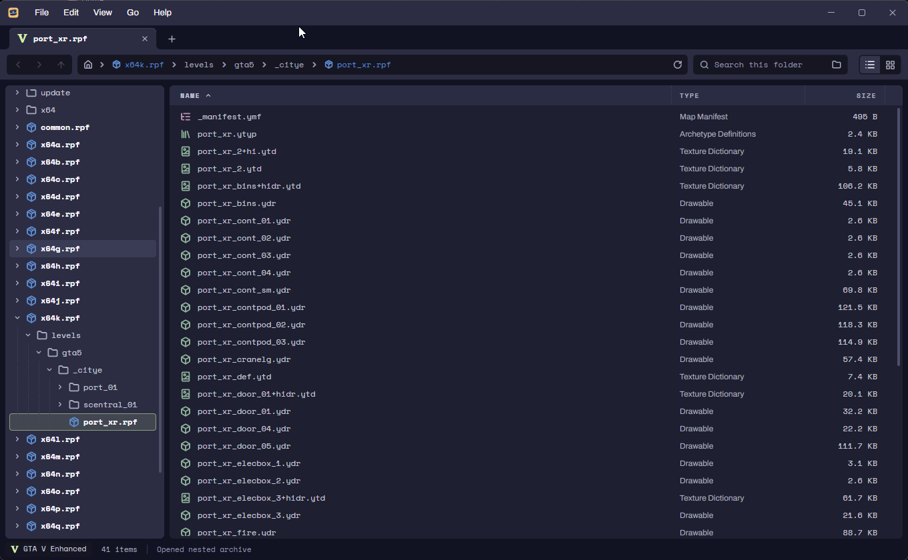
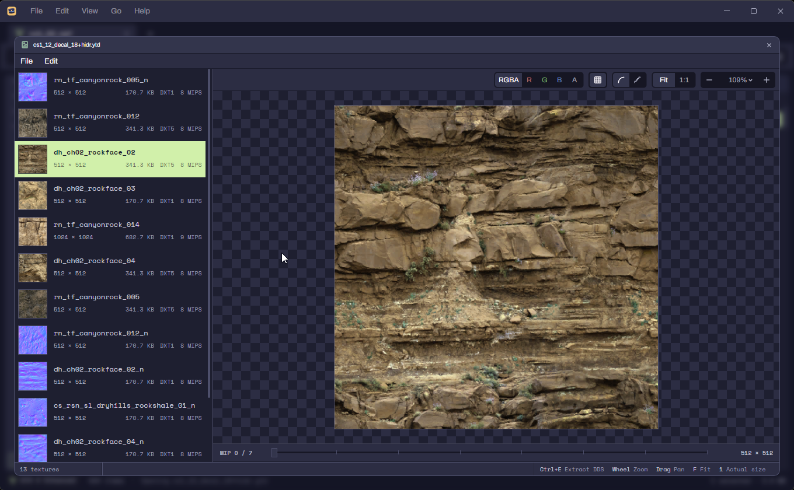

<p align="center"></p>

<p align="center">
A modding toolkit for games, for Windows.<br>
Browse a game's folders and archives, then open, edit, extract and repack what is inside them.
</p>

<p align="center"></p>

<table>
  <tr>
    <td width="50%"></td>
    <td width="50%"></td>
  </tr>
  <tr>
    <td align="center">Fly through Red Dead Redemption 2's world</td>
    <td align="center">Fly through GTA V's world</td>
  </tr>
  <tr>
    <td width="50%"></td>
    <td width="50%"></td>
  </tr>
  <tr>
    <td align="center">Browse folders and archives, nested ones too</td>
    <td align="center">Inspect and extract textures, channel by channel</td>
  </tr>
</table>

## Features

- Browse a game's folders and RPF archives in tabs, with search.
- Fly through GTA V's and Red Dead Redemption 2's worlds, streamed around the camera and lit
  by each game's own sky, fog and time of day.
- Open models, vehicles, collisions and navmeshes in a 3D viewer that draws them with the
  game's own shaders and finds their textures wherever the game keeps them.
- Pick a vehicle's colours, a level of detail or the time of day, and save models back.
- View texture dictionaries by channel and mip, and extract textures as DDS.
- Read and edit text files, loose or inside RPFs.

Supported games: Grand Theft Auto V (Legacy and Enhanced) and Red Dead Redemption 2.

Built with .NET 10 and Avalonia.

## Building

You need the [.NET 10 SDK](https://dotnet.microsoft.com/download), this repository's
CommonFury submodule (`git submodule update --init`), and checkouts of FiveFury.NET and
RedFury.NET beside this repository's parent folder (`..\..\FiveFury.NET`,
`..\..\RedFury.NET`), or point `FIVEFURY_ROOT` and `REDFURY_ROOT` at them. Both build on
this repository's CommonFury, so their own submodules aren't needed.

```sh
dotnet build HikariHopper.slnx -c Release
dotnet run --project src -c Release
```

## Tests

```sh
dotnet test --solution HikariHopper.slnx
```

Real-asset checks run when `HIKARI_TEST_LEGACY` points to a GTA V Legacy installation; they
only read from it.

## Releasing

Releases are Native AOT builds, so users don't need .NET installed. Publishing needs the
Visual Studio C++ build tools.

```sh
pwsh tools/release.ps1 -GameRoot "D:\Path\To\Grand Theft Auto V"
```

The script publishes the AOT build and fails on any AOT compiler warning. It then runs
`HikariHopper.exe --self-test` on the native binary against the game and checks that the window
opens. [Velopack](https://velopack.io) (`vpk`, pinned in `dotnet-tools.json`) packs it into
`artifacts\`: the zip people download, which updates itself, and the files the app's updater
reads from the GitHub release. The script ends with the `gh release create` command that
publishes them, with the version's changelog section as the notes.
